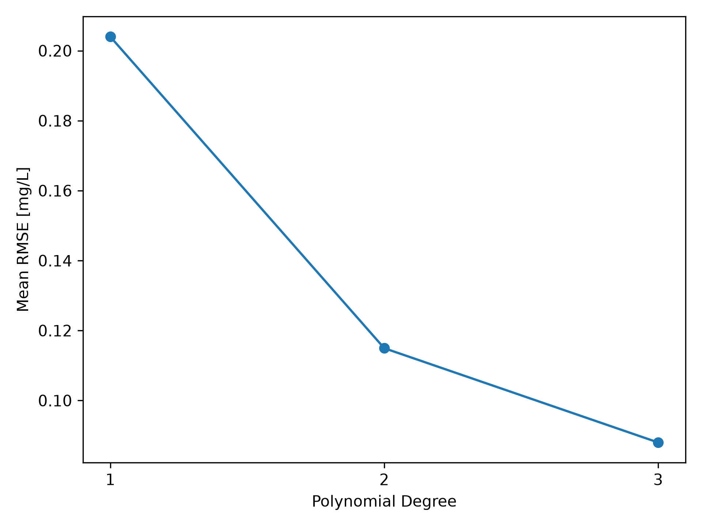
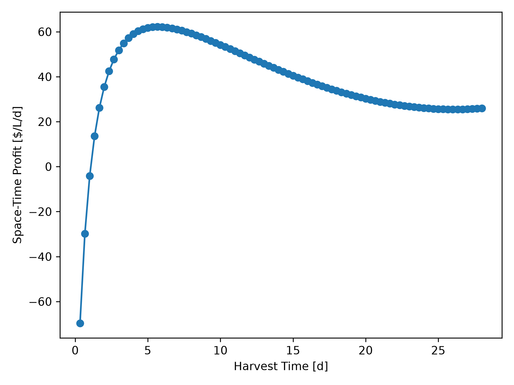
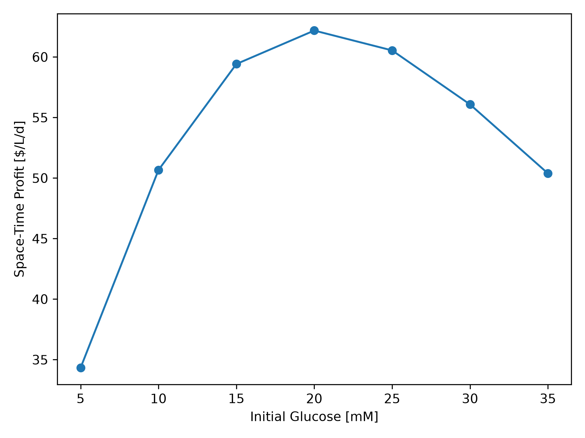
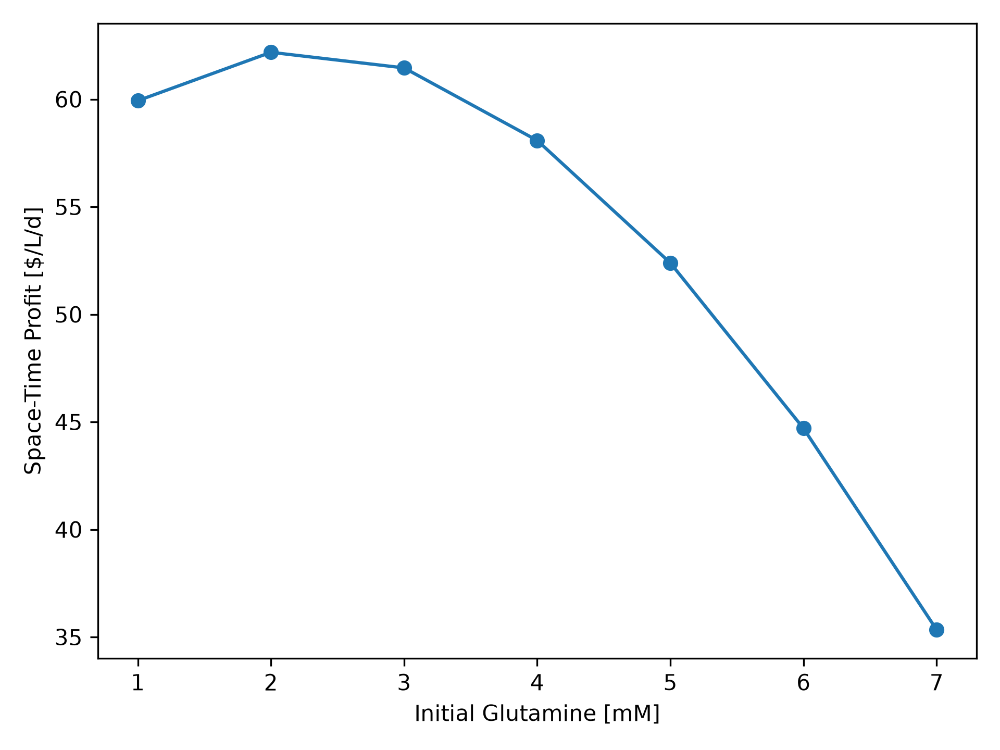
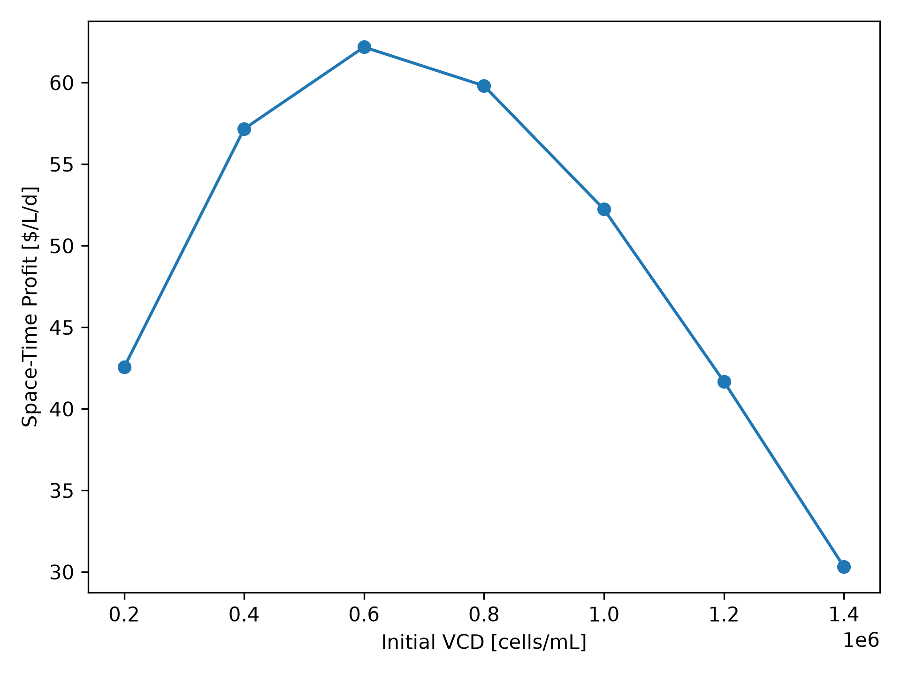

# Monoclonal Antibody Production Optimization
This project uses machine learning to optimize monoclonal antibody production based on initial glucose concentration, glutamine concentration, viable cell density, and harvest time. A polynomial regression model is used to predict mAb concentration and determine the operating conditions that maximize space-time profit. Model performance is evaluated using validation results, prediction intervals, and process performance metrics.
## Highlights
- Selected 30 batch runs to cover the range of initial glucose, glutamine, and viable cell density conditions.
- Developed and validated a polynomial regression model to predict monoclonal antibody concentration.
- Optimized initial conditions and harvest time to maximize space-time profit.
- Evaluated the recommended operating conditions using space-time yield and 95% prediction intervals.
## Environment
- Python 3.14.7
- Matplotlib 3.11.2
- NumPy 2.5.3
- pandas 3.0.6
- scikit-learn 1.9.0
## Code Design
### Data Selection and Preparation
The project begins by loading the initial conditions and the 30 selected batch files. The batches were selected to provide coverage across the available ranges of initial glucose concentration, glutamine concentration, and viable cell density (VCD). This allows the model to learn from low, intermediate, and high operating conditions without requiring all available batch runs.

Each batch file is assigned its corresponding batch ID and combined into a single DataFrame. The initial conditions are then matched to each batch using the batch ID. The initial glucose, glutamine, and VCD values are added to the time-series data so that each measurement can be connected to the conditions used at the start of the batch.

The economic and process performance variables are then calculated. Harvest time is converted from hours to days, and the initial operating cost is calculated from the glucose, glutamine, and VCD values. The mAb concentration is used to calculate product value and profit. Space-time profit (STP) and space-time yield (STY) are then calculated using the harvest time and the required one-day downtime between batches.
### Model Development and Validation
A polynomial regression model is used to predict mAb concentration from the initial glucose concentration, initial glutamine concentration, initial VCD, and harvest time. The model is built using a scikit-learn pipeline that first standardizes the input variables, creates polynomial features, and then fits a linear regression model.

Polynomial degrees of 1, 2, and 3 are compared to determine the model complexity that provides the best predictions. Leave-one-batch-out validation is used for the comparison. During each validation step, one complete batch is used as the test data while the remaining 29 batches are used for training. This process is repeated until every batch has been used for testing. Keeping each complete batch together prevents measurements from the same batch from appearing in both the training and test data.

The root mean squared error (RMSE) is calculated for each test batch. The mean and maximum RMSE values are then compared across the three polynomial degrees. Degree 3 produces the lowest mean and maximum RMSE and is therefore selected for the final model. The validation results are saved as a table and plotted to show the effect of polynomial degree on prediction error.
### Process Optimization

After selecting the degree 3 polynomial model, the model is trained using all 30 selected batches. The fitted model is then used to evaluate combinations of initial glucose concentration, glutamine concentration, VCD, and harvest time. The glucose, glutamine, and VCD levels are kept within the original experimental ranges, while the available harvest times are taken from the batch data.

For each combination, the model predicts the mAb concentration. The predicted concentration is then used to calculate product value, profit, space-time profit, and space-time yield. The operating condition with the highest space-time profit is selected as the recommended condition. This approach considers both mAb production and the cost and time required to operate the process rather than selecting conditions based only on product concentration.

The complete optimization results are stored in a DataFrame so that the effects of each operating variable can also be examined. These results are used to create figures showing how harvest time, initial glucose, initial glutamine, and initial VCD affect process performance.
### Prediction Intervals and Output
Prediction uncertainty is estimated using the residuals produced during leave-one-batch-out validation of the degree 3 model. The 2.5th and 97.5th percentiles of the validation residuals are used to create 95% prediction intervals around the predicted mAb concentration at the recommended operating condition. These limits are then converted into prediction intervals for product value, space-time profit, and space-time yield.

The final results are exported to CSV files for easier review. The model comparison table contains the mean and maximum RMSE for each polynomial degree, while the optimization summary contains the recommended operating conditions, predicted process performance, and prediction intervals. Figures are also generated to show model validation and the effects of harvest time and initial conditions on process performance. Together, these outputs provide both the final recommendation and the information needed to evaluate how the model reached that result.
## Analysis
### Batch Selection and Model Performance
The 30 batch runs were selected to provide broad coverage of the available operating space while limiting the amount of data required for model development. The selected batches include low, intermediate, and high values of glucose, glutamine, and VCD, as well as combinations throughout the experimental range. This provides the model with information from different regions of the operating space instead of concentrating the selected runs around a small number of conditions. A limitation of this approach is that only one run is used for many of the selected operating conditions, which reduces the ability to directly evaluate variation between replicate batches.

Polynomial degrees of 1, 2, and 3 were evaluated using leave-one-batch-out validation. The degree 1 model produced a mean RMSE of 0.2040 mg/L and a maximum RMSE of 0.4277 mg/L. Increasing the polynomial degree to 2 reduced the mean RMSE to 0.1150 mg/L and the maximum RMSE to 0.2019 mg/L. The degree 3 model provided the best performance, with a mean RMSE of 0.0880 mg/L and a maximum RMSE of 0.1367 mg/L.

|Degree|Mean RMSE [mg/L]   |Maximum RMSE [mg/L]|
|------|-------------------|-------------------|
|1     |0.2039850533775082 |0.42765702446304676|
|2     |0.11494986665932104|0.20186651096768085|
|3     |0.08799701504480067|0.1366763366122957 |

The decrease in validation error as polynomial degree increases indicates that the relationship between the operating variables, harvest time, and mAb concentration is nonlinear. Degree 3 was therefore selected for the final model because it produced the lowest prediction error of the models tested. The improvement in both mean and maximum RMSE also indicates that the degree 3 model provided more consistent predictions across the different batches.
### Model Comparison 
A recursive vector autoregression (VAR) model was also evaluated as an alternative approach. The VAR model used previous process measurements to predict future values and initially showed strong performance for one-step predictions. However, the optimization requires predictions to be made from the initial operating conditions without having future measured values available. When the VAR model was used recursively for this purpose, prediction errors accumulated over time.

Across the selected batches, the recursive VAR model produced a mean RMSE of approximately 0.1847 mg/L, compared with 0.0880 mg/L for the degree 3 polynomial model. The maximum recursive VAR RMSE was approximately 0.4131 mg/L, while the maximum error for the degree 3 model was 0.1367 mg/L. The direct polynomial model therefore provided more accurate and consistent predictions for the intended optimization.

The direct model also has the advantage of connecting the variables that can be selected before a batch begins directly to the predicted mAb concentration. This makes it possible to evaluate different combinations of initial glucose, glutamine, VCD, and harvest time without recursively predicting the complete time series. A limitation is that polynomial regression is an empirical model and does not directly represent the biological mechanisms responsible for cell growth and mAb production.
### Effect of Harvest Time
Harvest time has an important effect on space-time profit because increasing the batch duration allows more mAb to be produced but also reduces the number of batches that can be completed over time. At the recommended initial conditions, space-time profit initially increases as harvest time increases. Very early harvests do not produce enough mAb value to recover the initial operating cost, resulting in low or negative profitability.

The model predicts a maximum space-time profit at a harvest time of approximately 5.67 days, or 136 hours. Beyond this point, the additional value obtained from extending the batch is not sufficient to compensate for the longer operating cycle. Space-time profit therefore begins to decrease even though mAb may continue to be produced. This demonstrates the importance of considering both production and time when selecting the harvest point.

Space-time yield shows a different relationship with harvest time because it measures mAb production per unit of time without considering the cost of the initial operating conditions. This difference shows why space-time profit is the more appropriate optimization objective for this process. A condition can provide a high production rate while still being economically unattractive if the cost of operating the batch is too high.
### Effects of the Initial Conditions
The initial glucose concentration affects both mAb production and operating cost. At the recommended glutamine concentration, VCD, and harvest time, space-time profit increases as glucose rises from 5 mM to 20 mM. The highest predicted space-time profit occurs at 20 mM glucose. Increasing the glucose concentration beyond 20 mM causes space-time profit to decrease, indicating that the additional glucose cost is not matched by a large enough increase in mAb value.

Initial glutamine shows a similar tradeoff. The highest space-time profit is predicted at 2 mM glutamine, although the results at the lower glutamine concentrations are relatively close. As glutamine concentration continues to increase, space-time profit decreases. The additional cost of higher glutamine concentrations therefore provides limited economic benefit under the recommended operating conditions.

Initial VCD also has a clear effect on process performance. Increasing VCD from 200,000 cells/mL improves space-time profit until a maximum is reached at approximately 600,000 cells/mL. At higher initial VCD values, space-time profit decreases. Although a larger initial cell population can support mAb production, VCD also contributes directly to the initial operating cost. The results therefore indicate that using the highest available VCD is not the most profitable strategy.

Overall, the results show that maximizing the individual initial conditions does not maximize process profitability. Intermediate glucose and VCD values combined with a relatively low glutamine concentration provide a better balance between mAb production and initial operating cost. These trends support the recommended conditions of 20 mM glucose, 2 mM glutamine, and 600,000 cells/mL VCD.
### Recommended Conditions
TThe final optimization recommends an initial glucose concentration of 20 mM, an initial glutamine concentration of 2 mM, an initial VCD of 600,000 cells/mL, and a harvest time of approximately 5.67 days. At these conditions, the model predicts an mAb concentration of approximately 0.955 mg/L. The initial operating cost is \$540/L, while the predicted product value is \$954.56/L, resulting in a predicted profit of approximately \$414.56/L.

The recommended conditions produce a predicted space-time profit of \$62.18/L/d and a space-time yield of 0.1432 mg/L/d. The 95% prediction interval for product value ranges from \$795.68/L to \$1,122.21/L. The corresponding space-time profit interval ranges from \$38.35/L/d to \$87.33/L/d, while the space-time yield interval ranges from 0.1194 to 0.1683 mg/L/d. Although the intervals show uncertainty in the predicted process performance, the complete space-time profit interval remains positive at the recommended conditions.

|Metric|Value              |
|------|-------------------|
|Initial Glucose [mM]|20.0               |
|Initial Glutamine [mM]|2.0                |
|Initial VCD [cells/mL]|600000.0           |
|Harvest Time [d]|5.666666666666667  |
|mAb [mg/L]|0.9545582358698118 |
|Cost [$/L]|540.0              |
|Value [$/L]|954.5582358698118  |
|Value 95% PI Lower [$/L]|795.6810829788714  |
|Value 95% PI Upper [$/L]|1122.2095400017465 |
|STP [$/L/d]|62.183735380471774 |
|STP 95% PI Lower [$/L/d]|38.352162446830704 |
|STP 95% PI Upper [$/L/d]|87.33143100026197  |
|STY [mg/L/d]|0.14318373538047177|
|STY 95% PI Lower [mg/L/d]|0.11935216244683071|
|STY 95% PI Upper [mg/L/d]|0.16833143100026196|
The recommended conditions represent a balance between product formation, operating cost, and batch duration. The optimization does not select the highest available nutrient concentrations or VCD because the additional cost of these conditions does not provide enough additional product value. Similarly, extending the harvest time beyond the recommended point reduces space-time profit. The selected conditions therefore provide the highest predicted economic performance within the operating space evaluated by the model.
### Limitations and Final Assessment 
The model provides a useful method for identifying profitable operating conditions, but several limitations should be considered. Only 30 batch runs were used from the full available dataset, so the model does not directly observe every possible combination of initial conditions. The selected batches were distributed across the operating space to reduce this limitation, but some predictions are still based on interpolation between the selected runs.

The polynomial regression model is also empirical rather than mechanistic. It can represent nonlinear relationships in the available data but does not directly account for the biological mechanisms controlling cell growth, nutrient consumption, or mAb production. In addition, using a degree 3 polynomial increases model flexibility and could increase the risk of overfitting. Leave-one-batch-out validation was used to evaluate this risk, and the lower validation error of the degree 3 model supports its use over the simpler models tested.

Prediction intervals provide an estimate of the uncertainty associated with the final recommendation. However, these intervals are based on the residuals from the selected batch data and should not be interpreted as guarantees of future process performance. Additional experimental runs near the recommended conditions would provide a useful next step for confirming the predicted optimum and evaluating batch-to-batch variability.

Overall, the results indicate that the most profitable process does not require the highest nutrient concentrations, the largest initial cell population, or the longest batch duration. The recommended combination of 20 mM glucose, 2 mM glutamine, 600,000 cells/mL initial VCD, and a 5.67-day harvest time provides the best predicted balance between mAb production, operating cost, and process time. Based on the model, these conditions provide a space-time profit of \$62.18/L/d while maintaining a positive lower bound of \$38.35/L/d within the estimated 95% prediction interval.